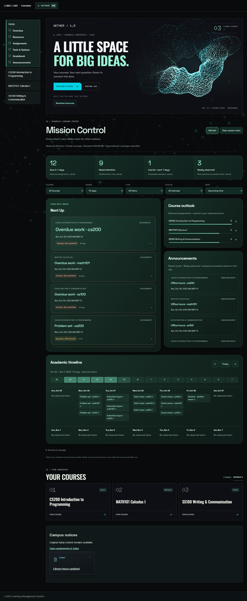

# Aether LMS

A cleaner, calmer interface for **LUMS Sakai**. Aether is a free, open-source Chrome extension that adds course cards, document previews, and a glowing starfield to your existing LMS.

**Current version: 1.5.0 · Mission Control · Public beta · MIT licensed**

Works on [lms.lums.edu.pk](https://lms.lums.edu.pk). This is an independent project, unaffiliated with LUMS or the Sakai project.

*Screenshot uses fictional courses and test content.*

## Install in five steps

1. On this GitHub repository, select **Code → Download ZIP**.
2. Extract the ZIP into a folder you intend to keep.
3. Open `chrome://extensions` in Chrome and enable **Developer mode**.
4. Select **Load unpacked**, then choose the extracted folder containing `manifest.json`.
5. Open or refresh your LUMS LMS tab. Sign in normally.

No build, terminal commands, or separate account needed. Keep the extracted folder: Chrome loads the extension from that location.

To update, back up your current folder, replace its contents with the new version, select **Reload** on Aether's extension card, and refresh your LMS tabs. Keep the same folder location and only one Aether installation enabled to retain your saved preferences.

## Features

| Area | What Aether adds |
|---|---|
| Home | Hero, pinned courses, then Mission Control: observed academic counts, Next Up, a planning timeline, announcements and course outlook. **View deadlines** jumps straight to the dashboard; saved course order remains available. |
| Navigation | Reorder course and tool shortcuts with drag-and-drop or keyboard buttons; your order is saved locally. |
| Appearance | Dark panels, mint and cyan accents, bundled fonts, page-wide stars, glowing sparkles, pointer glow, and contour lines. |
| Folded field | A procedural 3D particle sculpture with progressive startup and a Canvas fallback when WebGL is unavailable. |
| Course dissolve | Pinned course titles and the Mission Control heading assemble from local particles as they enter and dissolve at the opposite scroll edge. Course links stay native; keyboard focus, reordering, Motion Off, and the system reduced-motion preference retain readable text. |
| Resources | Cards for student, TA, and instructor browsing views, including supported management lists and embedded Sakai tools. |
| Resource collections | Select files, nested folders and available courses in one download basket. Exclude individual descendants, review discovery, then export a ZIP preserving the hierarchy. |
| Native resource controls | Original file and folder links, action menus, selection checkboxes, sorting, pagination, and permitted add/upload/delete controls remain available. Editing fields retain their native layout. |
| Assignments | Full-card color fills in the v1.3 style and text badges distinguish submitted, not submitted, due soon (24 hours), due shortly (2 hours), overdue, not open, revision, excused, and cancelled states when confirmed by Sakai. Draft, grade, feedback, and confirmed late-submission badges remain separate. Unknown states stay neutral. |
| Gradebook | Cards for read-only grade summaries, including scores, feedback, and release states. Editable grade grids and comparison tables keep their layout with matching styling. |
| Roster | Matching cards, photo views, and tables, retaining permitted profile details, groups, search, sorting, and pagination. |
| Other lists | Recognized announcement and activity lists receive matching styling where supported. |
| File previews | Read supported Resources files and assignment/draft attachments inside the LMS, with larger readers, resizing, and expand/restore controls. Files stay local to the LMS and bundled reader. See the formats below. |
| File states | Cyan Unopened, slate Opened, violet Updated when version changes are confirmed, and labeled access/preview failures. Open history stays on this device and can be cleared in the preview footer. Hovering does not mark files opened. |
| Copyright notices | Read the native notice in the preview and choose **Yes, accept and preview** to continue in the same panel. Acceptance requires your click. |
| Hover behavior | Hover briefly to preview; moving away from both the resource and panel closes it immediately. Select **Preview** to keep a reader open. |
| Accessibility | Keyboard controls, visible focus, Escape to close previews, responsive layouts, and support for your system's reduced-motion preference. |
| Your choice | **AETHER ON/OFF** restores the original Sakai layout. **MOTION ON/OFF** controls animation separately and saves your preference. |

Native authentication, access permissions, forms, and actions remain in Sakai. Aether does not grant access to hidden grades or restricted files. Mission Control reports observed records and explicitly labels partial or unavailable coverage; it cannot guarantee a complete semester inventory.

## Mission Control (1.5)

Home brings accessible coursework into one read-only planning view. **View deadlines** in the hero jumps past your pinned courses to Mission Control. **Next Up** leads with approaching deadlines and events; past-due assignments remain available in a separate counted group. Unknown submission states stay neutral and drafts remain distinct from submitted work. The summary strip follows the selected course and clearly labels its next-seven-days window, independently of the timeline range and type/status filters. It counts observed assignments due, verified items needing attention, upcoming events and newly observed announcements. Missing sources or a missing prior announcement baseline show **—**, never a fabricated zero.

Combine **Course**, **7 / 14 / 30 days**, **Type**, **Status** and **Sort**. Status filters use verified submission facts only. Timeline arrows move through the period; **Today** returns to the current period. Density bars and course outlook count actual dated assignments/events, without estimating difficulty. Undated records stay available in Next Up. Announcements use the selected number of recent days rather than a future timeline period. An active-filter summary makes the current selection clear; **Reset filters** returns to the default view. Controls keep their selection during in-page updates and do not refetch metadata.

Use **Refresh** for a fresh check while keeping current results, reading position and keyboard focus available. Returning to a visible Home tab refreshes data older than five minutes; there is no continuous background course scan. Original item links remain native. API calendar/announcement records open the discovered original course tool where available, otherwise the course page; choose its Calendar or Announcements tool for the full record. **Clear session data**, inside **Sources & coverage**, clears this view and its announcement baseline. OFF, navigation, logout and observed account changes cancel reads and clear the view. The next check establishes a new baseline.

### Sources and current limits

- Identity reuses Aether's authenticated `/direct/session/current.json` helper. If identity is unavailable or anonymous, academic reads are blocked.
- Courses combine original navigation with one bounded `/direct/site.json?select=access&_limit=50&_start=0` read. This is accessible-site discovery, not proof of every enrollment.
- Assignments use discovered **native student assignment lists**, including supported Sakai tool frames and the modern/legacy `listAssignmentsForm` template. Titles, links, due dates and student status cells are read; instructor lists, hidden rows and future opening dates are excluded. Ambiguous dates remain unavailable, and missing status remains unknown. Only the current native list page is read; pagination is not driven.
- `/direct/assignment/my.json` and `/direct/assignment/site/{siteId}.json` were investigated but are **not requested**. The [upstream provider](https://github.com/sakaiproject/sakai/blob/4debc94780cc41758aebfbbe2583d11364edd09b/assignment/tool/src/java/org/sakaiproject/assignment/entityproviders/AssignmentEntityProvider.java) enumerates context assignments and its generic list contract does not establish student release/group visibility. Assignment canonical status is not submission status. No other students' submissions, grades or assignment instructions are imported.
- Events use one date-bounded `/direct/calendar/my.json` read (30 days back / 90 days ahead). The [upstream calendar provider](https://github.com/sakaiproject/sakai/blob/4debc94780cc41758aebfbbe2583d11364edd09b/calendar/calendar-tool/tool/src/java/org/sakaiproject/calendar/entityproviders/CalendarEventEntityProvider.java) applies calendar access checks but can silently skip inaccessible calendars. `/direct/calendar/site/{siteId}.json` exists upstream but is not additionally scanned. Assignment-generated events are excluded to avoid revealing unreleased assignment titles or duplicating student-list deadlines. Recurrences are displayed only as returned; no occurrences are invented. Visible native summary events remain the fallback.
- Announcements use `/direct/announcement/site/{siteId}.json?n=20&d=30`, with native course/Home summaries as fallback. The [upstream announcement provider](https://github.com/sakaiproject/sakai/blob/4debc94780cc41758aebfbbe2583d11364edd09b/announcement/announcement-tool/tool/src/java/org/sakaiproject/announcement/entityprovider/AnnouncementEntityProviderImpl.java) checks read permission, viewability, date ranges and drafts. Bodies and attachments are not retained. **Newly observed** means absent from the previous successful check in this tab, never newly published; an old post can be newly observed.
- Checks scan at most eight discovered courses, prioritize existing navigation, deduplicate reads, use at most three concurrent requests, cap individual metadata responses at 2 MiB and total metadata at 16 MiB, and time out requests after eight seconds. English native schemas are recognized conservatively. Unsupported layouts and missing tool links are reported in **Sources & coverage**.

**Authenticated LUMS deployment compatibility is unverified.** Upstream contracts and fictional intercepted-browser checks do not establish the deployed Sakai version, endpoint availability, native markup or enrollment coverage. If APIs fail, supported native student lists and visible summaries still supply useful observed records. If those also cannot be recognized, the dashboard says unavailable and retains original course navigation; this is limited functionality, not a fully verified cross-course release.

After reloading the extension in the existing folder, check Home against two real course assignment lists: course association, exact due time/timezone, submitted versus draft status, one Calendar event and one announcement. Inspect **Sources & coverage**, follow original links, then try OFF and verify that Sakai's original interface returns. Do not make a test submission. If Sakai omits timezone information, confirm the displayed time against its original field.

Mission Control keeps normalized records and its bounded announcement comparison baseline only in page memory. It adds no permissions, durable academic storage, analytics or remote processing. See [PRIVACY.md](PRIVACY.md).

Submitted assignments stay mint even after their deadline. A **Late** badge requires an explicit native late status or a confirmed submission timestamp after the applicable due date. **Draft saved** does not mean submitted. Due dates remain visible in Sakai's original fields, with relative time labels updating automatically. Opened-file history starts when this feature is used and does not reconstruct past reading activity. See [PRIVACY.md](PRIVACY.md) for storage details.

## Download resources

Select **Download resources** in Resources or the Home/course workspace. **Add to download basket** adds an individual record. These controls are separate from Sakai's native management checkboxes and never mark a file Opened.

Expand a course or folder to browse its metadata. Check a folder to include its accessible descendants, then uncheck children to exclude them. **Discover available courses** can add authenticated API results beyond the navigation courses; this is not a guarantee that every LUMS enrollment is listed. Search and file-type filters cover discovered metadata and preserve selections.

Select **Review selection** before exporting. Failed or incomplete enumeration is shown explicitly; retry it or approve an export of only the discovered items. Copyright notices require a separate acceptance for each protected resource, or you can skip it. Failed files are listed, and keeping a partial archive requires confirmation.

**Download ZIP** opens Chrome's save dialog immediately from your click and streams one file at a time. The direct export ceiling is 2 GiB including archive overhead. Where direct saving is unsupported or blocked, the explicit **Download small ZIP (64 MiB)** option has a strict output limit, including unknown-size files. Larger ZIP64 archives are not advertised as supported. Native **Open original** links remain the fallback.

Keep the page open while exporting. The basket lives only in this page's memory, expires after 30 minutes of inactivity, and clears on logout/account change, navigation or Aether OFF. Closing a running operation asks before cancelling; OFF cancels immediately. An aborted save can leave a newly chosen destination empty; it is never reported as a completed ZIP. No background download service or extra Chrome permission is used.

Read the [selection and compatibility report](docs/V1.4_ARCHITECTURE.md) and [verification/limitations](docs/V1.4_RELEASE_REPORT.md). Live authenticated LUMS API compatibility and the native save-dialog destination flow still require manual validation.

## Preview formats

Hover over a resource or select **Preview**. Use **Open original** whenever you need the native file or application.

Selecting **Preview** opens a larger reader that stays open while you read. Use **Expand** to fill the window, **Restore** to return, or drag the bottom-right corner to resize. You can also focus the resize button and use the arrow keys. PDF readers offer zoom, **Fit page**, and **Fit width**; wide or enlarged pages can be scrolled. Supported file links in assignments and saved drafts have the same Preview control alongside the original link.

| Format | Preview |
|---|---|
| PDF | Pages with Previous/Next buttons and arrow-key navigation. |
| PowerPoint `.pptx` | Static slides with text, shapes, embedded images, tables, supported charts, and slide navigation. |
| Word `.docx` | Scrollable document with text, tables, and supported layout. |
| Excel `.xlsx` | Visible worksheet selector, cell values, and stored formula results. Formulas are not recalculated. |
| Images | Common browser-supported images, including PNG, JPEG, GIF, WebP, BMP, and AVIF. |
| Text and code | Plain-text excerpts, including source code, CSV, and JSON. Content is displayed without executing it. |
| Audio and video | Browser-supported playback controls; codec support depends on Chrome. |
| ZIP archives | File names and sizes inside the archive. |
| Folders | A short read-only listing, with the native folder link available. |

Office previews are readers, with no document editing, macros, or slide animations. Advanced effects and formatting may differ from Microsoft Office. Legacy binary formats such as `.ppt`, `.doc`, and `.xls`, encrypted documents, unsupported codecs, and files blocked by site policy use **Open original**.

Preview limits are 12 MB for PDFs/images, 32 MB for Office files/archives/media, 128 KB for text, and 1 MB for folder responses. Large text is excerpted. Spreadsheet previews show up to 500 rows and 50 columns, excluding hidden content; slides are limited to 600. Archive expansion is bounded. Details are in [Privacy and file handling](PRIVACY.md).

## Privacy and permissions

The extension requests `storage` to remember preferences and runs only on `https://lms.lums.edu.pk/*`. It reads the LMS page and fetches previews from that same LMS using your existing signed-in session. Preview files are cached temporarily in memory; Chrome may also apply its normal HTTP cache.

Fonts and readers are bundled locally. There are no analytics, external document uploads, or cloud conversion services. See [PRIVACY.md](PRIVACY.md) for details.

## Compatibility and testing

The focused `npm run test:mission` check uses fictional intercepted requests with the real unpacked extension, including modern/legacy student lists, tool frames, cross-course records, filters, source failures, hidden/future exclusions, account/OFF cancellation, native actions and desktop/phone layouts. Existing startup, sign-in, assignment-state, Gradebook and shared downloader checks remain available; no live LMS credentials or test submissions are required.

The v1.3.1 reliability checks use fictional, intercepted Sakai fixtures and the real unpacked extension. They cover preview cancellation, history concurrency and account isolation, native controls, copyright consent, startup routes, graphics fallbacks, and large dynamic lists. See the [release audit](docs/V1.3.1_AUDIT.md) and [verification report](docs/V1.3.1_RELEASE_REPORT.md) for results, environment details and limitations.

**Live authenticated LUMS compatibility has not been independently verified.** Custom Sakai tools, permissions, and security policies can vary. Treat this as a public beta and report problems using fictional or redacted examples. If a page looks wrong, switch Aether off to use the native layout.

## Contributing

The extension runs directly from source. Development tests use Node.js, Python 3, and Playwright. See [CONTRIBUTING.md](CONTRIBUTING.md) for setup, testing, packaging, and the source layout. See [CHANGELOG.md](CHANGELOG.md) for release history and [SECURITY.md](SECURITY.md) for reporting security issues.

Contributions go through pull requests, automated Windows/Linux browser regressions, package checks, dependency review, and security analysis before merging. Updates are reviewed by the maintainer; passing tests do not automatically publish or merge changes.

## License

Aether's first-party code is available under the [MIT License](LICENSE). Bundled libraries and fonts retain their own licenses; see [THIRD_PARTY_NOTICES.md](THIRD_PARTY_NOTICES.md).
