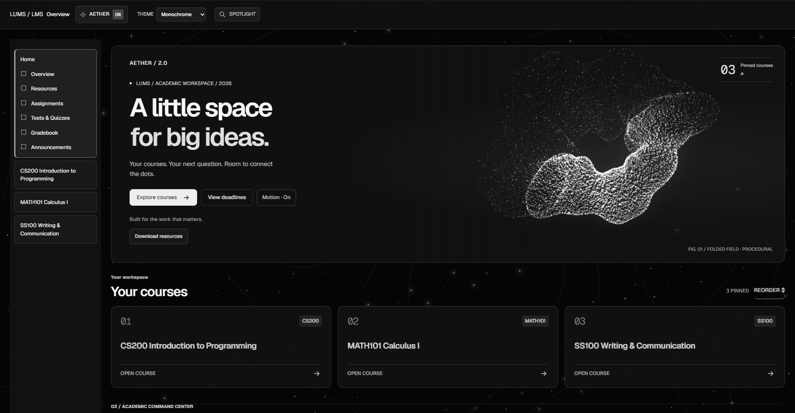
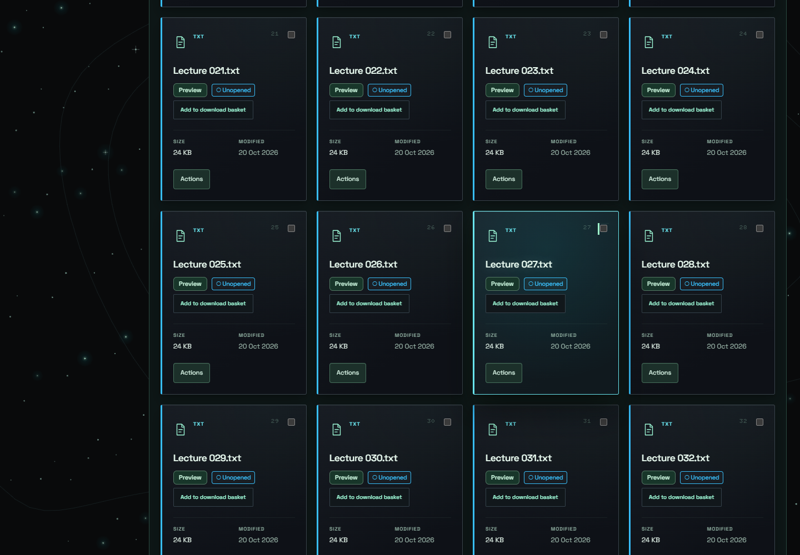
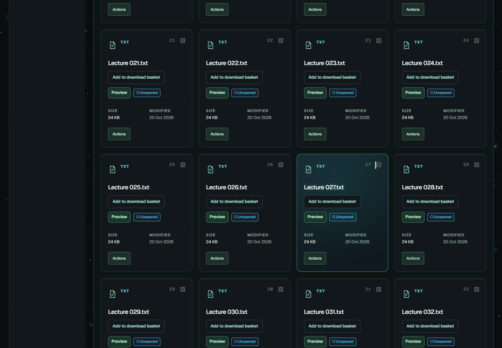
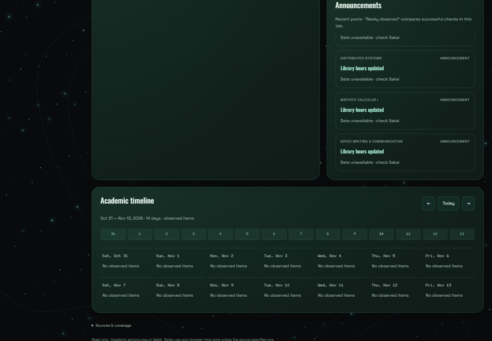
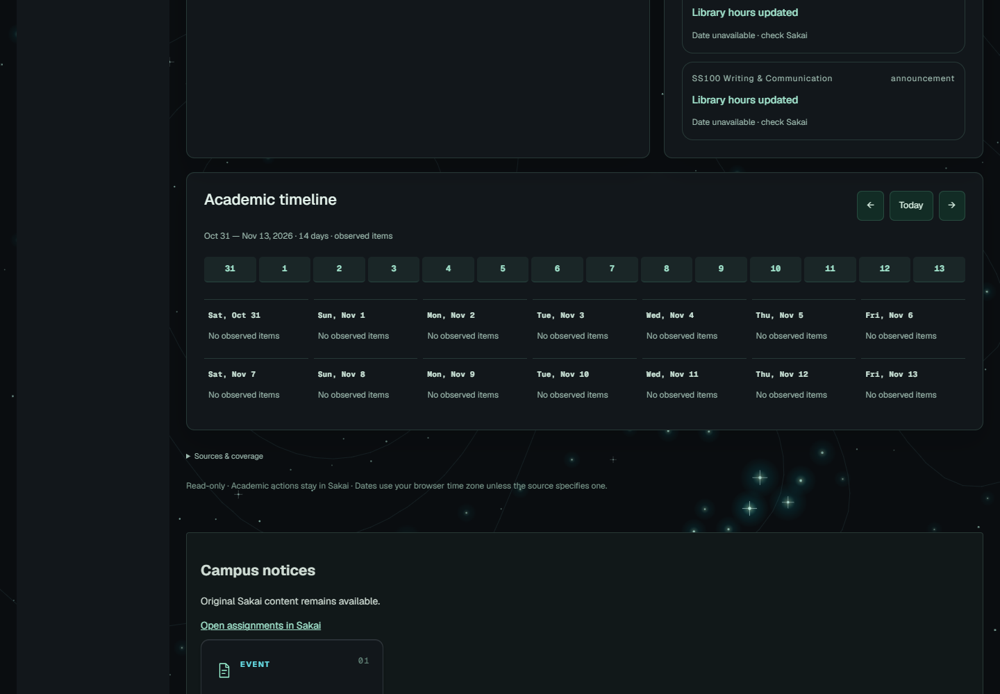

# Aether 2.0 visual review

The final matrix captures the actual unpacked extension against fictional Sakai fixtures: **120 views = 12 contexts × 5 widths × 2 themes**. Widths are 390, 775, 1024, 1440 and 1920px. Contexts are Home, course overview, assignments, Gradebook, statistics, Resources, native action menus, text preview, PDF preview, Mission Control, Spotlight and Download Manager. All captures have no page-level horizontal overflow or uncaught script errors, and record loaded Geist Sans/Mono assets.

All ten review sheets were visually inspected, covering typography, alignment, spacing, focus, native menus, clipping, contrast and static loading appearance. Fixes from review include mobile CTA wrapping, resource actions crowding titles, enlarged-text header overflow, Monochrome's secondary-button hierarchy, and preservation of assignment status fills. Native authored documents keep their content fonts. The reduced-motion composition is intentionally complete, with a local static folded field. Ten additional live WebGL captures cover both themes at the five widths; the 1440px Original, 390px Monochrome and 1920px Monochrome compositions were inspected at full size.

| Width | Original review | Monochrome review |
|---|---|---|
| 390px | [12 contexts](evidence/v2/review-aether-390.jpg) | [12 contexts](evidence/v2/review-monochrome-390.jpg) |
| 775px | [12 contexts](evidence/v2/review-aether-775.jpg) | [12 contexts](evidence/v2/review-monochrome-775.jpg) |
| 1024px | [12 contexts](evidence/v2/review-aether-1024.jpg) | [12 contexts](evidence/v2/review-monochrome-1024.jpg) |
| 1440px | [12 contexts](evidence/v2/review-aether-1440.jpg) | [12 contexts](evidence/v2/review-monochrome-1440.jpg) |
| 1920px | [12 contexts](evidence/v2/review-aether-1920.jpg) | [12 contexts](evidence/v2/review-monochrome-1920.jpg) |

## Actual screenshots

[Mobile Home](evidence/v2/aether-390-home.png), [Monochrome Spotlight](evidence/v2/monochrome-1440-spotlight.png), [narrow Gradebook](evidence/v2/monochrome-775-gradebook.png), [125% root-zoom overflow check](evidence/v2/enlarged-text-390.png).

## Before / after comparisons

These pairs use the same performance fixture and scroll/open/close sequence. Changed typography/geometry means the visible record position is not a pixel-matched screenshot diff.

| Workload | v1.8.2 | v2.0.0 |
|---|---|---|
| 300-file Resources |  |  |
| Home / planning after scrolling |  |  |

The fixture sidebar glyphs and statistics canvas are deliberately simple fictional stand-ins; they are not captures of real course navigation or a real grade distribution. Native Sakai icons and Chart.js are handled by the retained adapters. The Instagram reel could only be inspected as an excerpt, so no detailed reel technique is claimed. These screenshots do not establish authenticated live-LUMS compatibility.
