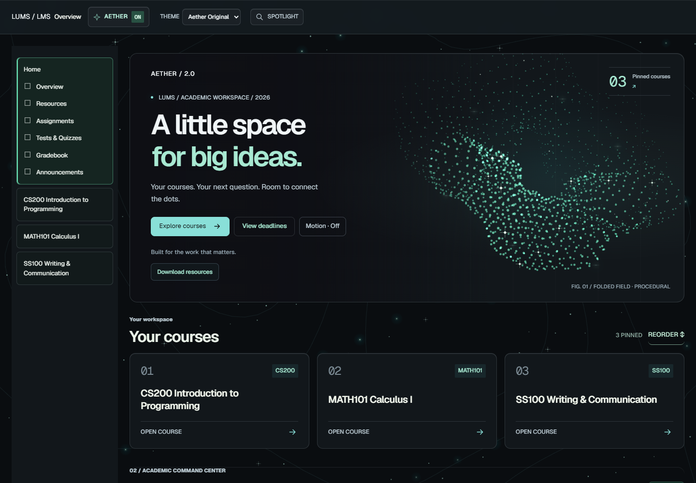
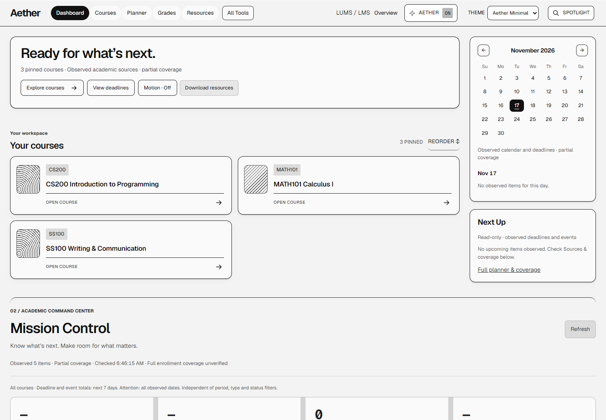

# Aether 2.1 — verification and limits

Baseline: merged 2.0 commit `efafa9b6434d46be21522a15b6fb1f054277f33a`. Recoverable checkpoint: `checkpoint/before-2.1-minimal`. Implementation branch: `aether-2.1-minimal`.

## Presentation and native navigation

Minimal is a third persisted value in the existing appearance setting. `minimal.css` supplies neutral light tokens and scoped geometry; `minimal.js` supplies navigation and the dashboard arrangement. Geist assets, controllers and permissions remain shared. Original and Monochrome retain their layouts. Reader frames inherit the selected appearance; authored document contents retain their own colors and typography.

The primary navigation shares the original header with its native controls. All Tools reveals the actual native sidebar DOM, restores temporarily opened native hidden/inert/ARIA attributes on close, and returns keyboard focus. Current-course contextual links resolve the current native anchor when activated, preserving replacement handlers and native routes. Unknown navigation markup remains visible. Course shortcut reordering remains accessible in a compact disclosure. Global course/Gradebook/Resources destinations come from observed navigation and the existing academic store; absent coverage has explicit fallback text.

Home uses real pinned sites, CSS-only grayscale card artwork, an actual month calendar and read-only Next Up. The existing account-scoped store supplies records without another discovery pipeline. No percentages, completion checkboxes, arbitrary images or invented academic records are added. Calendar API failure is distinguished from observed native summaries. The existing Mission Control minute clock updates time-dependent presentation; there is no new polling timer. Its initial source check waits one paint in Minimal. Decorative canvas/ambient allocation is skipped in Minimal while motion preferences remain saved for the other appearances.

## Visual review

The real unpacked extension was captured with fictional intercepted Sakai responses at 390, 775, 1024, 1440 and 1920 px. The 65-view matrix covers Home, All Tools, course overview/context navigation, assignments, Gradebook/statistics, Resources/native menus, full Mission Control, Spotlight, text/PDF readers and Download Manager. Overview sheets and selected full-size images were inspected, followed by corrections to header wrapping, drawer stacking/close access, duplicate tool navigation, card density, neutral glyphs and hero gradients. Long-name/many-site, empty and failed-calendar fixtures are checked separately.

Review sheets: [390](evidence/v2.1/review-390.jpg), [775](evidence/v2.1/review-775.jpg), [1024](evidence/v2.1/review-1024.jpg), [1440](evidence/v2.1/review-1440.jpg), [1920](evidence/v2.1/review-1920.jpg). Full matrix metadata: [65 captures](evidence/v2.1/visual-matrix.json).

| Fictional Home fixture | Retained 2.0 | Minimal |
|---|---|---|
| Desktop |  |  |
| Mobile | [Before](evidence/v2.1/v2-home-mobile.png) | [After](evidence/v2.1/minimal-home-mobile.png) |

Selected full-size contexts: [Resources](evidence/v2.1/resources.png), [Gradebook](evidence/v2.1/gradebook.png), [statistics](evidence/v2.1/statistics-mobile.png), [Spotlight](evidence/v2.1/spotlight.png), [PDF](evidence/v2.1/pdf-preview.png), [Download Manager](evidence/v2.1/download-manager.png). Reference images guide composition only; fictional test records never enter production code.

## Reproducible performance comparison

Windows desktop, Playwright 1.65.1 / Chromium 159, 1440×1000, DPR 1, headless, no CPU throttle. Three measured warm samples per view/appearance/motion state. Resources has 300 fictional records. Both versions use identical fixtures and measurement code, sequentially paired by motion mode. Scroll restoration is disabled and every measured navigation asserts an initial scroll position of zero. Earlier runs exposed a non-comparable restored-scroll condition and are excluded from this table. Raw records include long tasks, frame intervals, layout shifts, requests and renderer JS heap.

All values below are medians, milliseconds, **2.0 → Minimal**. “Controls mounted” is DOM readiness, not a guarantee that all pixels have painted or an end-to-end Sakai TTI measurement.

| View | Controls mounted | First content paint | Script work during probe | Spotlight open |
|---|---:|---:|---:|---:|
| Motion On · home | 285 → 176 | 560 → 300 | 625 → 269 | 126 → 102 |
| Motion On · resources | 386 → 239 | 348 → 408 | 1584 → 1137 | 275 → 248 |
| Motion Off · home | 245 → 196 | 396 → 336 | 211 → 270 | 118 → 124 |
| Motion Off · resources | 309 → 283 | 256 → 492 | 1185 → 1024 | 269 → 275 |

Results are mixed: full-motion main-thread work and mounted-control times improve, while Resources first paint is later (especially with Motion Off). Motion Off Home script work also rises because the dashboard has additional functional controls. Do not describe this as a universal startup or paint-speed improvement. Spotlight remains around the baseline with normal host variation. No requests were observed in the final 500 ms idle window of these samples. Renderer heap after forced GC is lower in these comparisons; this does not measure total process/GPU memory or prove absence of leaks.

An extra-frame navigation mount initially caused Resources CLS around 0.60. Mounting it in the same adapter render reduced it to roughly 0.03, close to the retained baseline. Neutral SVG ink replaces per-record grayscale filters. Minimal retains the existing offscreen/batched list adapters, bounded indexing and session cache.

Raw data: [2.0 Motion On](evidence/v2.1/v2-controlled-full.json), [Minimal Motion On](evidence/v2.1/minimal-controlled-full.json), [2.0 Motion Off](evidence/v2.1/v2-controlled-motion-off.json), [Minimal Motion Off](evidence/v2.1/minimal-controlled-motion-off.json).

## Functional and release gates

Focused tests cover counts/dates, real links/handlers, Back/Forward, native forms, unsupported navigation, storage persistence, OFF/ON, frame/PDF appearance, mobile drawer access, private-source clearing, long names, empty lists and unavailable calendars. Repeated theme/calendar/drawer cycles sample forced-GC DOM/listener/heap counters. Existing browser, theme, academic, search, extraction/cache, downloader, startup, package and security regressions remain required in GitHub CI. Local results: 19/19 Minimal checks, the existing 80/80 general smoke cases, and the existing theme suite pass. A separate eight-view comparison with the retained 2.0 checkout matches Original/Monochrome geometry, fonts and surface colors exactly after source checks settle. [Functional evidence](evidence/v2.1/functional.json) and [preservation evidence](evidence/v2.1/preservation.json) are retained. After five warmup cycles and ten measured theme/calendar/drawer cycles, forced-GC counters change from 1,377 to 1,377 nodes and 198 to 198 event listeners; renderer JS heap changes from 4,717,576 to 4,930,200 bytes. This is bounded retention evidence, not proof of zero growth/leaks.

GitHub's required PR checks remain the authoritative release gate, including the full general, academic, search/content/session-cache, downloader/retention, startup, package and security checks. Installation follows their successful result; syntax/render-only success is insufficient.

## Limits

All automated requests use fictional intercepted data. Authenticated live LUMS and role-specific/custom Sakai controls still require read-only manual validation. No academic submission, grade change, upload, deletion or other operational live-portal action was performed. Source coverage remains bounded/partial; records absent from authorized discovery are not inferred. These tests do not establish field INP, universal 60 FPS, native OS save-dialog completion, total GPU/process memory or every deployment's compatibility. The new first-paint tradeoffs above remain visible in the report.

The existing Chrome installation path and junction must be retained. Deployment follows critical validation, using the same folder; reload Aether in `chrome://extensions`, refresh LMS, then choose **Aether Minimal**. No second installation, backend, telemetry, new permission or remote executable code is introduced.
